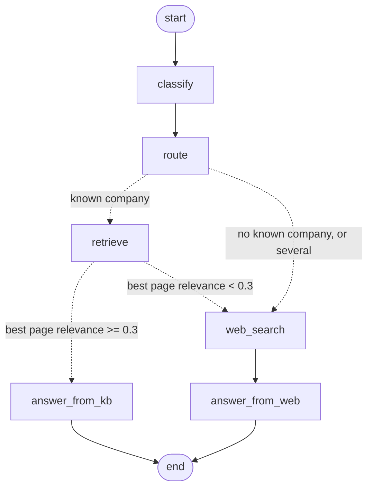

# rag-demo

A question-answering demo over company annual reports (PDF), following the approach in
[Ilya Rice: How I Won the Enterprise RAG Challenge](https://abdullin.com/ilya/how-to-build-best-rag/).

The knowledge base is 5 annual reports from round 2 of the
[Enterprise RAG Challenge](https://github.com/trustbit/enterprise-rag-challenge), with the organizers'
manually proofread gold answers for 17 questions. The winner's answers from
[IlyaRice/RAG-Challenge-2](https://github.com/IlyaRice/RAG-Challenge-2) (MIT) serve as a second reference.

## Roadmap

- [x] Project skeleton
- [x] Download dataset (5 annual reports + 17 questions with gold answers)
- [x] Parsing: PDF -> per-page Markdown with Docling (keep page numbers and tables)
- [x] Cleaning: inspect parse quality, regex cleanup of broken text
- [x] Tagging: LLM-extracted document metadata, checked against `subset.csv`
- [x] Ingestion: 300-token chunks (50 overlap), one FAISS index per company, page number in chunk metadata
- [x] Retrieval: company routing -> vector search -> parent page -> LLM reranking
- [x] Answering: prompt routing by answer type, structured output with CoT and page references
- [x] Evaluation: compare against the gold answers and the winner's answers on 17 questions
- [x] LangGraph workflow, web search fallback via MCP
- [x] FastAPI service
- [ ] Postman collection, temporary public link
- [ ] Dify version for comparison

Table serialization is left out on purpose: the original author found it slightly hurt results.
It may come back later as an optional experiment.

## Setup

Requires Python 3.12 and [uv](https://docs.astral.sh/uv/).

```bash
uv sync
cp .env.example .env   # then add your OPENAI_API_KEY
```

## Data

```bash
uv run python -m rag_demo.download
```

Downloads into `data/erc2/` (git-ignored). Each source is pinned to a fixed commit, and each PDF
is named by its SHA-1 and verified after download.

The 5 companies have the most single-company questions among the 100 competition reports.
6 of the 17 gold answers are N/A, which tests whether the system makes up answers.
The 8 multi-company comparison questions are out of scope: none of them involve only these 5 companies.

| Company | Pages | Questions |
|---|---|---|
| AA Limited | 62 | 4 |
| HCA Healthcare, Inc. | 133 | 4 |
| Wheeler Real Estate Investment Trust, Inc. | 93 | 3 |
| Ritchie Bros. Auctioneers Incorporated | 144 | 3 |
| Albany International Corp. | 131 | 3 |

| File | Content |
|---|---|
| `pdf_reports/*.pdf` | 5 annual reports, 563 pages in total |
| `subset.csv` | Organizer metadata and tags (LLM-extracted by the organizers, used to generate questions) |
| `questions.json` | 17 questions with gold answers and gold page references (converted to 1-based) |
| `answers_ilya.json` | The winning system's answers to the same questions |

## Parsing

```bash
uv run python -m rag_demo.parse            # all reports, or pass sha1 prefixes
```

Uses [Docling](https://github.com/docling-project/docling) with table structure on and OCR off
(OCR is only needed for documents with a broken text layer). Output in `data/erc2/`:

- `parsed/<sha1>.docling.json`: full Docling document, so later steps can re-export without re-parsing
- `pages/<sha1>.json`: Markdown per page, 1-based page numbers

On an Apple M4 it takes about 1 s per page (about 10 minutes for all 563 pages).
The first run also downloads Docling's layout and table models.

## Cleaning

```bash
uv run python -m rag_demo.clean
```

Re-exports each page from the saved Docling JSON (no re-parsing) into `pages_clean/<sha1>.json`.

- Docling export options do most of the work: compact tables (the column padding was 18-32% of
  all characters), no HTML/underscore escaping, no image placeholders.
- A few regexes remove table-of-contents dot leaders and extra whitespace.
- A quality check flags documents with a broken text layer (glyph codes, garbled words) so they can be
  re-parsed with `--ocr`. None of the 5 reports needed it.
- Page headers and footers need no extra handling: Docling already excludes them from the body.

| Report | Before | After | Smaller |
|---|---|---|---|
| AA Limited | 521,073 | 383,243 | 26% |
| HCA Healthcare | 669,508 | 547,248 | 18% |
| Wheeler REIT | 442,499 | 298,808 | 32% |
| Ritchie Bros. | 659,037 | 492,093 | 25% |
| Albany International | 540,368 | 389,245 | 28% |

## Tagging

```bash
uv run python -m rag_demo.tag
```

Extracts document metadata with `gpt-4o-mini` structured output and writes `data/erc2/metadata.json`.

- Input: the first pages of each report (up to 15k characters), plus the 3 most frequent
  "year ended <date>" phrases from the whole report. The first pages often name only the report year:
  AA's "Annual Report 2021" covers the year ended 31 January 2022.
- Fields: legal name, aliases and tickers, currency, industry (the organizers' list), period end.
- Routing list: the organizer name plus the extracted names and aliases, mapped to the report's sha1.
  It is used later to route a question to the right company index.

Compared with the organizer metadata (`subset.csv`, also LLM-extracted):

| Field | Match |
|---|---|
| Company name (ignoring legal suffixes like "Inc.") | 5/5 |
| Currency | 5/5 |
| Industry | 4-5/5 |
| Period end | 5/5 (checked by hand) |

Industry is the one unstable field. Albany International makes paper machine fabrics and aerospace
composites, so runs alternate between "Aerospace & Defense" (the organizers' label) and "Technology".
It is not used for routing.

Short aliases such as "AA" can appear inside other words, so routing must match whole words and
prefer the longest name.

## Ingestion

```bash
uv run python -m rag_demo.ingest
```

Writes `data/erc2/indexes/<sha1>.faiss` and `<sha1>.chunks.json` (chunk id, page number, text).

- Chunks never cross page boundaries and record their page number, so a hit can be expanded
  to its full parent page during retrieval.
- 300-token chunks with 50-token overlap, split by LangChain's `RecursiveCharacterTextSplitter`
  on Markdown structure (headings, paragraphs, lines), measured with the `cl100k_base` tokenizer.
- `text-embedding-3-small`, one `IndexFlatIP` per company. Flat means exact search, and inner
  product equals cosine similarity because OpenAI embeddings are unit length.

| Report | Pages | Chunks |
|---|---|---|
| AA Limited | 61 | 405 |
| HCA Healthcare | 132 | 566 |
| Wheeler REIT | 92 | 381 |
| Ritchie Bros. | 143 | 541 |
| Albany International | 130 | 474 |

2,367 chunks and 491,563 tokens in total, about $0.01 to embed.

Quick check with plain vector search: for 7 of the 8 questions with gold pages, a gold page is among
the pages of the top-5 chunks. The miss is Albany's "R&D spending on advanced programs".

## Retrieval

```bash
uv run python -m rag_demo.router   "Did AA Limited announce any new product launches?"
uv run python -m rag_demo.retrieve "Did AA Limited announce any new product launches?"
uv run python -m rag_demo.retrieve --no-rerank "..."
```

1. **Company routing** (`router.py`): whole-word match against the routing list, longest name first.
   Tickers of 4 characters or less match case-sensitively, so "AA" or "AIN" in ordinary words are ignored.
   No LLM needed: 17/17 questions route correctly.
2. **Vector search**: top 30 chunks in that company's index.
3. **Parent pages**: chunks are mapped to their full pages, deduplicated, keeping the best chunk score.
4. **LLM reranking**: `gpt-4o-mini` scores pages 2 at a time from 0 to 1, with the original prompt
   (`prompts.py`). Combined score = 0.7 × LLM score + 0.3 × vector score. Top 10 pages are returned.

One change from the original schema: each ranking also returns its block number. Scores used to be
matched to pages by list position, and the model sometimes returned them out of order. In one batch
the AA cash flow statement (page 37) got the score meant for the other page, 0.2 instead of 0.9.

Rank of the first gold page, on the 8 questions that have gold pages:

| | Gold page at #1 | In top 3 | In top 10 |
|---|---|---|---|
| Vector search only | 4/8 | 6/8 | 7/8 |
| With LLM reranking | 7/8 | 7/8 | 7/8 |

The miss is Albany's "R&D spending on advanced programs": the report says "Company-funded research
expenses totaled $31.4 million". The wording differs so much that the page ranks 32nd in vector search,
outside the 30-chunk sample, so reranking never sees it.

## Answering

```bash
uv run python -m rag_demo.answer --kind number "What was the Dividend per share (in USD) for Ritchie Bros. Auctioneers Incorporated?"
```

- One system prompt, example and schema per answer type (`name`, `number`, `boolean`, `names`), taken from
  the original project (`prompts.py`). The number prompt carries most of the rules: exact metric match only,
  no calculations, N/A on currency mismatch, scale by thousands or millions, parentheses mean negative.
- Structured output with chain of thought: the schema field order makes the model write a step-by-step
  analysis, then a summary, then the pages it used, then the final answer.
- Cited pages that were not among the retrieved pages are dropped.
- Answer model: `gpt-4o-mini` by default (`ANSWER_MODEL` in `.env`). The original won with `o3-mini`.

Two changes from the original:

- The boolean answer description said "if ... in context there is information about it, return False",
  the opposite of what was meant. Fixed to "if the context has no information about it, return False".
- The original padded page references to at least 2 pages, a scoring tactic for the competition.
  Left out here.

First run on all 17 questions: 12 match the gold answer, the winner's system gets 13. The only question
where the two systems differ is AA's new product launches: `gpt-4o-mini` reads new EV services as launches
(gold: False). Proper scoring follows in the evaluation step.

## Evaluation

```bash
uv run python -m rag_demo.evaluate --name baseline
```

Answers all 17 questions and scores them with the organizers' rules (`rank.py`), next to the winner's answers.
Each run is saved to `data/erc2/runs/<name>.json` with the settings used.

- Value score: numbers within 1%, booleans and names by equality, name lists by Jaccard overlap, N/A only matches N/A.
- Reference score: starts at 1, -0.1 per cited page that is not a gold page, -0.25 per gold page group missed.
- Total = value + reference / 2, at most 1.5 per question.

```bash
uv run python -m rag_demo.evaluate --name gpt-4o-mini --repeat 3   # mean, min, max over 3 runs
```

Answers change between runs even at temperature 0, so one run is not enough to compare settings.
Retrieval is nearly identical across runs; the changes come from borderline questions in answering,
for example whether removing cumulative dividend rights on preferred stock counts as a change
to Wheeler's capital structure.

| Run | Value | Reference | Total |
|---|---|---|---|
| Winner (`o3-mini`), its competition answers | 13/17 | 15.25/17 | 20.62/25.5 |
| `gpt-4o-mini`, mean of 3 runs | 12.67/17 (12-13) | 15.25/17 | 20.30/25.5 (19.73-20.68) |

Before N/A answers stopped citing pages, the reference score was 14.05 in a single run.

## Web search MCP server

```bash
uv run python -m rag_demo.mcp_server          # MCP over stdio
uv run mcp dev src/rag_demo/mcp_server.py     # try it in the MCP Inspector
```

`mcp_server.py` is a small MCP server written with the official Python SDK (`FastMCP`, `mcp` 1.x).
It exposes one tool, `web_search(query, max_results=5)`, returning title, URL and snippet per result.

- Search backend: DuckDuckGo through `ddgs`, no API key needed. Only `search()` depends on it.
  `ddgs` sometimes finds nothing for an ordinary query, so `search()` retries 3 times and then
  returns an empty list instead of a tool error. For steadier results, swap in a paid API such as Tavily.
- Transport: stdio. The client starts the server as a subprocess, so the server never prints to stdout.
- `mcp` is pinned below 2.0: version 2 renamed `FastMCP` and changed the client API, and
  `langchain-mcp-adapters` (used by the LangGraph workflow) requires `mcp<2`.

To use it from other MCP clients (Kiro, Claude Desktop), register the command
`uv --directory <path-to-rag-demo> run python -m rag_demo.mcp_server`.

## Workflow (LangGraph)

```bash
uv run python -m rag_demo.workflow --kind number "What was the Dividend per share (in USD) for Ritchie Bros. Auctioneers Incorporated?"
uv run python -m rag_demo.workflow "What was Apple's total revenue in fiscal 2022 in USD?"   # kind detected
uv run python -m rag_demo.workflow --mermaid
```



- `classify` asks the LLM for the answer type (number, boolean, name, names) when none is given,
  so free-form questions work. It is skipped when `--kind` is passed.
- `web_search` calls our MCP server through `langchain-mcp-adapters`, which starts it as a subprocess
  over stdio, the same way any MCP client would.
- `answer_from_web` uses the same answer types and `final_answer` rules as the knowledge base prompts,
  with numbered search results as context, and returns the URLs it used.
- An N/A answer from the knowledge base does not trigger a web search. For many questions N/A is the
  correct answer ("the report does not state this"), and a number from the web would be scored wrong.
- The relevance threshold is low on purpose. On the 17 test questions the best page always scores at
  least 0.4, including questions about metrics the report does not contain (gold N/A) and questions
  whose answer is on the page under different wording. Reranking scores cannot tell "the report lacks
  this" from "the report says it differently", so in practice the fallback fires on routing.
- The evaluation still uses the knowledge base only (`answer.answer`), as in the competition.

## HTTP API (FastAPI)

```bash
uv run python -m rag_demo.api          # http://127.0.0.1:8000/docs
```

| Method | Path | Key | Description |
|---|---|---|---|
| GET | `/health` | no | Liveness check |
| GET | `/companies` | yes | Companies in the knowledge base |
| POST | `/ask` | yes | `{"question": "...", "kind": null}` -> answer, source, page references or URLs, workflow trace |
| GET | `/docs` | no | Swagger UI to try the endpoints in the browser |

```bash
curl -X POST http://127.0.0.1:8000/ask \
  -H "X-API-Key: $API_KEY" -H "Content-Type: application/json" \
  -d '{"question": "What was the Dividend per share (in USD) for Ritchie Bros. Auctioneers Incorporated?"}'
```

Every `/ask` call costs OpenAI credits (about $0.005-0.01), so access is limited by default:

- `API_KEY` must be set in `.env`, or the server refuses to start. Clients send it as `X-API-Key`.
- At most 10 requests per minute per client IP and 200 per day in total (`RATE_LIMIT_PER_MINUTE`,
  `DAILY_REQUEST_LIMIT`). Counters live in memory and reset when the server restarts.
- Unexpected errors return `{"detail": "internal error"}`; details go to the server log only.
- The server listens on 127.0.0.1 only. Public access goes through a tunnel.
- Also set a monthly usage limit for the OpenAI key in the OpenAI dashboard.
